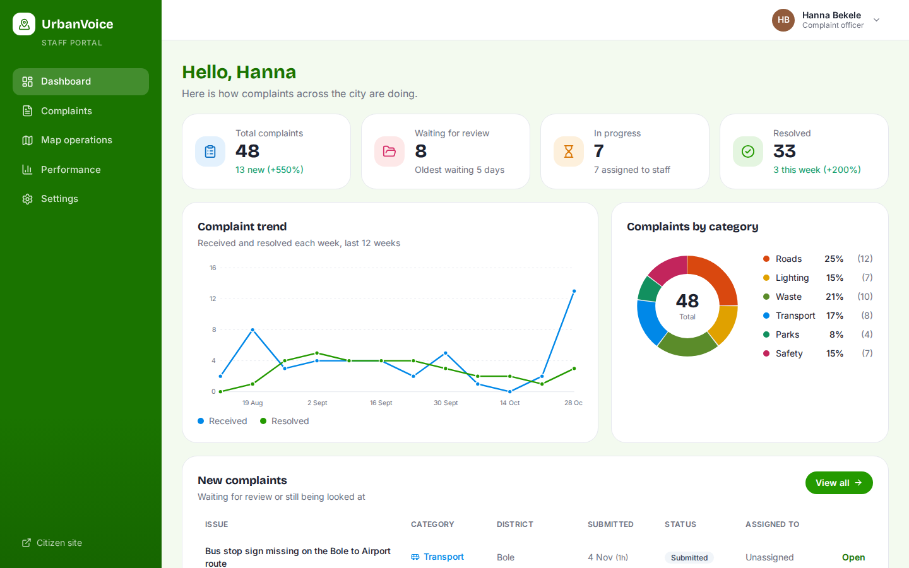
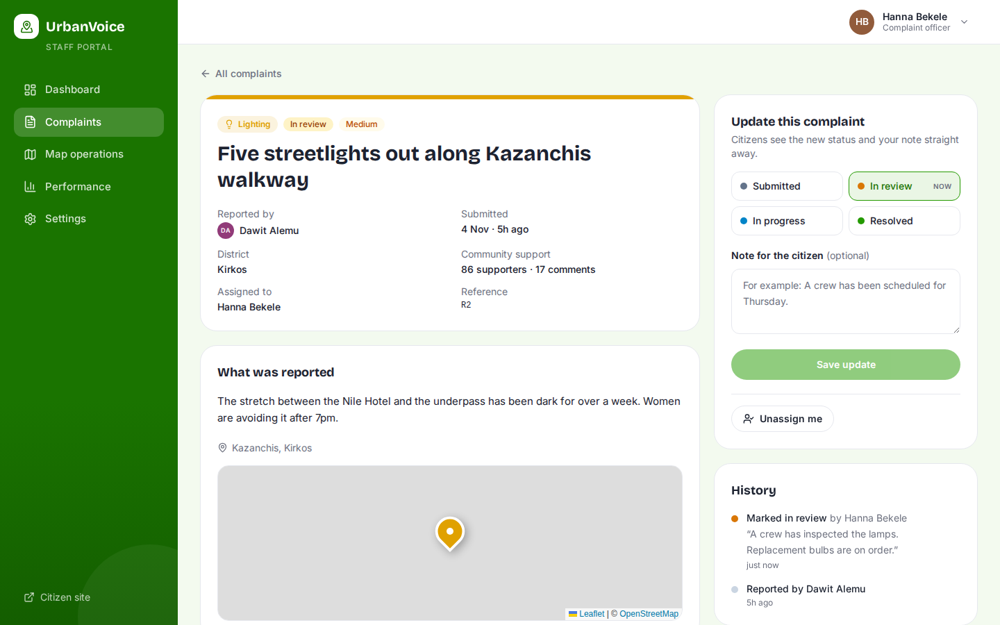
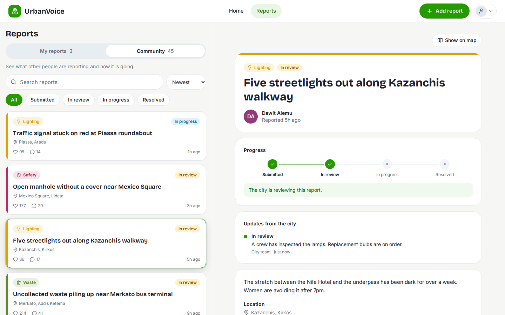
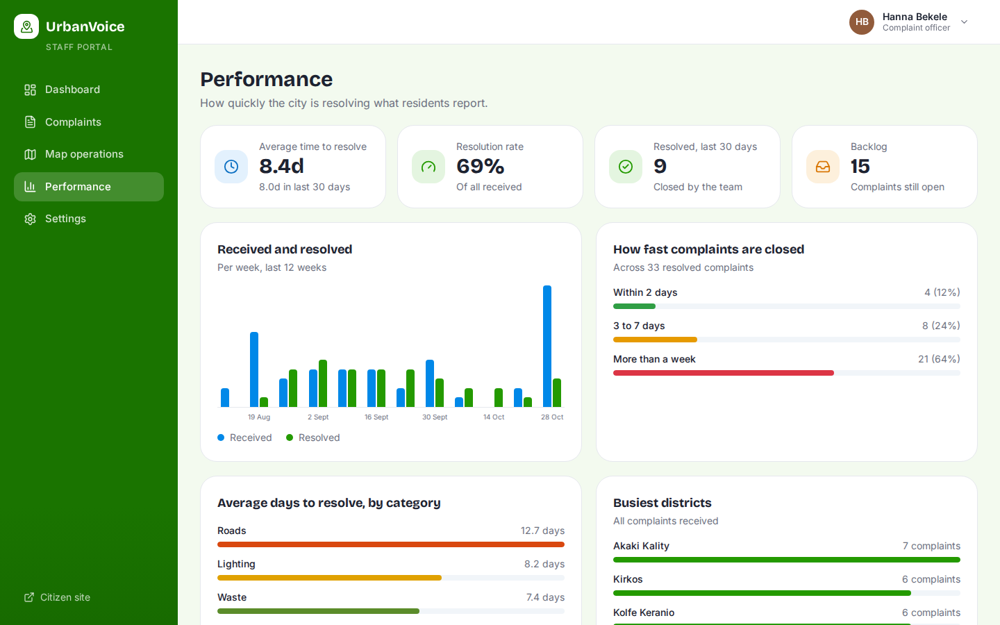
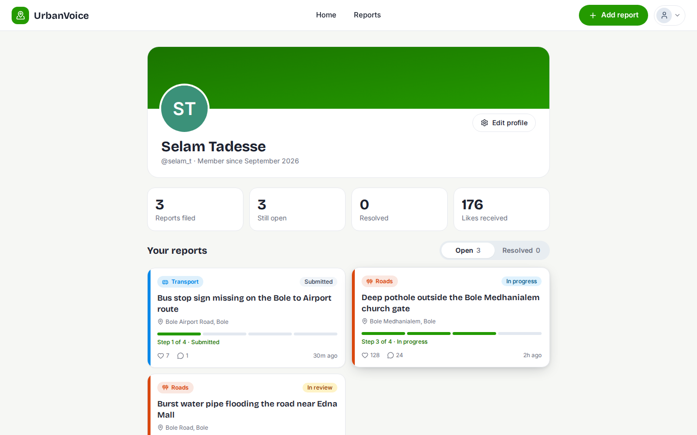
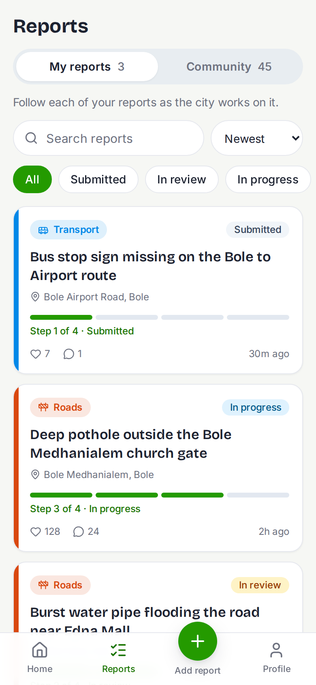

# UrbanVoice

**A civic complaint platform where residents report problems on a map and follow the city's response, and staff triage and resolve them.**

    

**Live app:** [urban-voiceful.vercel.app](https://urban-voiceful.vercel.app/)

Built by [@eyobazeze](https://github.com/eyobazeze). The whole stack runs on free tiers.

---

## What it does

UrbanVoice has two sides that share one database, so an action on one side shows up on the other.

**For residents**
- Report a problem in under a minute: pick a category, drop a pin on the map, add up to three photos (compressed in the browser before upload).
- Follow every report through four steps: Submitted, In review, In progress, Resolved. Notes from the city appear on the report.
- Browse what neighbours are reporting on a map, like and comment on reports, share a link, and delete your own reports.
- A profile with your reports and stats, and a settings page.

**For city staff** (`/gov`)
- **Dashboard:** open, in-progress and resolved counts, a 12-week trend, and complaints by category.
- **Complaints:** search, filter by status, category and district, and sort by priority.
- **Complaint page:** change the status, write a note the citizen can see, and assign the complaint. Every change is logged.
- **Map operations:** districts sized and colored by how much is waiting, or one pin per complaint.
- **Performance:** average time to resolve, resolution rate, weekly received vs resolved, and team workload.

## Screenshots

| Staff dashboard | Staff complaint page |
|---|---|
|  |  |
| **A citizen sees the city's update** | **Performance** |
|  |  |

| Profile | On a phone |
|---|---|
|  |  |

## Design and engineering decisions

- **Security lives in the database.** Access rules are Postgres row-level security policies (`supabase/schema.sql`), not just checks in the app. Citizens can only edit or delete their own reports. The staff role can only be granted from the Supabase SQL Editor, so nobody can promote themselves. Staff change statuses through one `security definer` function (`gov_set_status`) that checks the caller is staff and records the history.
- **A real demo mode.** With no Supabase keys, the whole app runs on sample data, kept in the visitor's browser (reports, likes, comments, deletes, staff updates). That makes the project easy to try and review without any setup, and it let me build and test both sides before the backend existed.
- **Built for free tiers.** Photos are resized to 1200px in the browser before upload. Maps use Leaflet with OpenStreetMap. Addresses come from the free Nominatim service. Charts are small hand-written SVG components rather than a charting library.
- **Modern Next.js.** App Router with Cache Components: pages stream, and live data sits behind `Suspense` boundaries. Session refresh and early redirects run in `proxy.ts`.
- **Priority is derived, not stored.** An open complaint is high priority when 100 or more neighbours back it or it has waited a week. The rules are in one file (`lib/analytics.ts`) and are easy to change.
- **Accessibility.** Keyboard-friendly controls, labelled form fields, status messages announced to screen readers, native dialogs, and reduced-motion support.
- **Safe redirects.** The `next` parameter after sign-in only accepts paths on this site.

## Tech stack

| Area | Tools |
|---|---|
| Framework | Next.js 16 (App Router), React 19, TypeScript |
| Styling | Tailwind CSS 4, Lucide icons |
| Backend | Supabase: Postgres, Auth, Storage, row-level security |
| Maps | Leaflet, OpenStreetMap tiles, Nominatim |
| Hosting | Vercel |

## Run it locally

You need Node.js 20.9 or newer.

```bash
git clone https://github.com/eyobazeze/urban-voice.git
cd urban-voice
npm install
npm run dev
```

Open <http://localhost:3000>. With no environment file the app starts in **demo mode**. Open the account menu and choose "Staff portal (demo)" to see the staff side.

## Connect your own Supabase project

1. Create a free project at [supabase.com](https://supabase.com).
2. In the **SQL Editor**, paste and run `supabase/schema.sql`. This creates the tables, security rules and the photo bucket. (If you set up an earlier version of the database, run `supabase/upgrade-staff-portal.sql` instead. It is safe to run again.)
3. Create a file named `.env.local` in the project folder with your project's URL and publishable key (Supabase: **Connect**, or **Settings, API Keys**):
   ```
   NEXT_PUBLIC_SUPABASE_URL=https://your-project.supabase.co
   NEXT_PUBLIC_SUPABASE_ANON_KEY=sb_publishable_...
   ```
   The variable keeps the name `ANON_KEY` even when you paste a publishable key. Restart `npm run dev` afterwards.
4. **Authentication, URL Configuration:** set the Site URL to `http://localhost:3000` and add `http://localhost:3000/auth/callback` as a Redirect URL. Confirmation emails link back through that address.
5. Sign up on the citizen site and confirm your email.

Supabase's built-in email sender allows only a few messages per hour on the free plan. That is enough for testing; for a public launch, add an SMTP sender such as Resend.

### Create a staff account

Staff are normal accounts with one extra flag. Sign up and confirm the email as above, then run this in the SQL Editor (use your own email):

```sql
update profiles set role = 'gov'
where id = (select id from auth.users where email = 'staff@example.com');
```

Then sign in at `/gov/login`.

## Deploy to Vercel

1. Push the repository to GitHub and import it in [Vercel](https://vercel.com).
2. **Before the first deploy**, add the two environment variables above. They are read at build time.
3. After deploying, add your live address to Supabase: set it as the **Site URL** and add `https://your-app.vercel.app/auth/callback` to the **Redirect URLs**.

To publish a second, no-backend copy that anyone can click through, deploy the same repository again **without** any environment variables.

## Project structure

```
app/
  (citizen)/     home map and feed, reports, add report, profile, settings
  (auth)/        login, signup, verify email
  gov/           staff login and the portal (dashboard, complaints, map, performance)
  auth/callback/ completes email confirmation
components/      UI, with components/gov/ for the staff portal
lib/             data access, analytics, demo-mode store, Supabase clients
supabase/        schema.sql and the upgrade script
proxy.ts         session refresh and route guards
```

## Roadmap

- Anonymous reporting
- In-app notification bell and email updates (for example with Resend)
- Live updates without refreshing
- Automated tests
- Amharic translation

## Credits

- The interface started from the [Urban Feedback - Complaint Platform (Community)](https://www.figma.com/community/file/1539251016512130689) Figma Community file, then was adapted and extended, including all of the working behavior and the pages the design didn't cover.
- Map data © [OpenStreetMap](https://www.openstreetmap.org/copyright) contributors.
